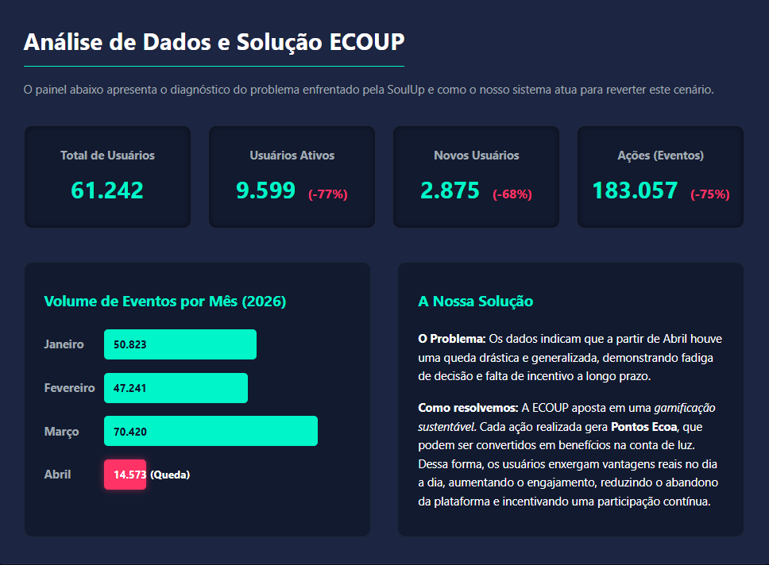

<p align="center">
  
</p>

# 🌱 ECOUP — Gamificação Sustentável

**Projeto acadêmico de incentivo a ações sustentáveis, desenvolvido para o desafio SoulUp.**


## 1. Apresentação e objetivo

A **ECOUP** é uma aplicação web **Single Page Application (SPA)** desenvolvida com React, Vite e TypeScript para o projeto Challenge da FIAP. A proposta é incentivar a participação da comunidade SoulUp em práticas sustentáveis por meio de uma experiência de gamificação.

A Sprint 4 conecta o Front-end a uma **API REST em Java/Spring Boot**, responsável por cadastrar participantes e armazenar/consultar registros de ações sustentáveis em um banco Oracle.

O projeto apresenta os **Pontos Ecoa** como uma estimativa visual associada à categoria da ação. O painel SoulUp utiliza indicadores do estudo de caso. **O protótipo não realiza reconhecimento automático de imagens/vídeos por IA, autenticação individual, ranking real ou concessão de descontos na conta de energia.** Esses recursos fazem parte da proposta de evolução da ECOUP.

## 2. Funcionalidades e páginas

| Página / rota | Funcionalidade |
| --- | --- |
| `/` | Home: apresentação da proposta e links para participar e explorar o projeto |
| `/participar` | Cadastro de participante pela API Java, com validação de formulário e mensagens de erro |
| `/simulador` | Registro de ação sustentável com título, categoria e link de evidência (`POST`) |
| `/acoes` | Listagem de ações registradas pela API (`GET`), com estados de carregamento, erro e lista vazia |
| `/acoes/:codigo` | Consulta individual de uma ação (`GET`), incluindo categoria, data, status e link da evidência |
| `/dashboard` | Indicadores do estudo de caso SoulUp, apresentados como dados de referência, com visualização de detalhes |
| `/recompensas` | Catálogo ilustrativo dos benefícios propostos pela ECOUP |
| `/recompensas/:id` | Detalhes da proposta de recompensa escolhida |
| `/sobre` | Propósito, contexto, solução e tecnologias |
| `/faq` | Perguntas frequentes e esclarecimentos sobre o protótipo |
| `/contato` | Formulário com validação local e mensagem na própria página (não envia e-mail) |
| `/integrantes` | Apresentação dos cinco integrantes, com fotos, RMs, turmas e links |
| Outras URLs | Página de endereço não encontrado (404) |

### Como funciona o registro de ações

1. A pessoa informa um **nome e e-mail fictícios** na página **Participar**. O cadastro é enviado à API Java.
2. O identificador do participante é guardado temporariamente no `sessionStorage` do navegador, durante a sessão da aba. **Isso não é autenticação de usuário.**
3. Em **Registrar ação**, a pessoa informa um título, escolhe **Mobilidade**, **Reciclagem** ou **Energia** e informa um link de evidência.
4. A aplicação envia o registro ao backend e direciona para a página de detalhes da ação.
5. A página **Ações** consulta a lista completa de registros disponíveis no endpoint da API. A pontuação visual é calculada no Front-end conforme a categoria; **não representa pontos aprovados nem saldo de usuário**.

> **Importante:** o protótipo **não recebe upload de vídeos**. Ele armazena somente a URL informada como evidência e não verifica automaticamente seu conteúdo. Utilize informações fictícias e links públicos de teste; não envie dados pessoais ou evidências privadas.

## 3. Tecnologias utilizadas

- **React e React DOM:** interface baseada em componentes e hooks.
- **Vite:** ambiente de desenvolvimento e geração da versão de produção.
- **TypeScript:** tipos, interfaces, tipos de união e interseção para os dados da API.
- **Tailwind CSS:** estilização e responsividade da interface.
- **React Router DOM:** navegação SPA com rotas estáticas e dinâmicas.
- **React Hook Form:** gerenciamento e validação dos formulários.
- **Fetch API nativa:** requisições HTTP ao backend, sem Axios.
- **Java / Spring Boot:** API REST desenvolvida na disciplina de Domain Driven Design Using Java.
- **Oracle Database:** persistência de participantes e ações pelo backend.
- **Git e GitHub:** versionamento e integração do trabalho da equipe.
- **Render e Vercel:** serviços previstos para a publicação do backend e do Front-end, respectivamente.

## 4. Estrutura de pastas

```text
README.md
my-app/
├── .env.example               # Exemplo de URL da API
├── .gitignore
├── index.html
├── package.json
├── package-lock.json
├── vercel.json                # Reescrita de rotas para a SPA
├── vite.config.ts
├── tsconfig.json
├── tsconfig.app.json
├── tsconfig.node.json
├── public/
│   └── img/                   # Imagens, ilustrações e fotos da equipe
└── src/
    ├── App.tsx                # Layout com cabeçalho, conteúdo e rodapé
    ├── main.tsx               # Configuração do React Router
    ├── global.css             # Estilos e integração com Tailwind
    ├── components/
    │   ├── Botao/
    │   ├── Cabecalho/
    │   ├── Cards/
    │   └── Rodape/
    ├── routes/
    │   ├── AcaoDetalhe/
    │   ├── Acoes/
    │   ├── Contato/
    │   ├── Dashboard/
    │   ├── Faq/
    │   ├── Home/
    │   ├── Integrantes/
    │   ├── NaoEncontrada/
    │   ├── Participar/
    │   ├── RecompensaDetalhes/
    │   ├── Recompensas/
    │   ├── Simulador/
    │   └── Sobre/
    ├── services/
    │   ├── api.ts              # Comunicação HTTP com a API Java
    │   └── participante.ts     # Identificação temporária na sessão
    └── types/
        └── types.ts            # Contratos e utilitários de tipagem
```

## 5. Como instalar e executar

**Pré-requisitos:** Git, Node.js e npm compatíveis com a versão do Vite utilizada no projeto; conexão com a internet para instalar as dependências.

### Clonar o projeto

Execute em um terminal:

```bash
git clone https://github.com/nicolaspk/ecoup-sprint4-front.git
cd ecoup-sprint4-front
```

> **Durante a integração da Sprint 4:** o desenvolvimento mais recente está na branch `feature/nicolas-rm574141`. Para testar essa versão antes de seu merge, use `git switch feature/nicolas-rm574141`. Após a integração final, utilize a `main` para a versão de entrega.

### Instalar dependências e configurar a API

Entre na pasta da aplicação:

```bash
cd my-app
npm ci
```

O arquivo `my-app/.env.example` informa a variável de ambiente utilizada:

```dotenv
VITE_API_URL=https://ecoup-sprint4-java.onrender.com
```

Para personalizar a configuração local, crie o arquivo `my-app/.env.local` com esse conteúdo. Se estiver rodando a API Java localmente, altere a URL para `http://localhost:8080`.

O serviço `src/services/api.ts` utiliza `VITE_API_URL`. Na ausência da variável, a aplicação utiliza `http://localhost:8080` como padrão. **Na Vercel, configure obrigatoriamente `VITE_API_URL` com a URL pública do backend.** Não inclua senhas nem credenciais Oracle no Front-end.

### Executar e verificar a compilação

Com o terminal dentro de `my-app`:

```bash
npm run dev
```

Abra o endereço indicado pelo Vite (normalmente `http://localhost:5173`).

Para verificar a compilação de produção:

```bash
npm run build
```

Para visualizar localmente a versão compilada:

```bash
npm run preview
```

> A execução completa depende de a API Java estar disponível e de sua conexão Oracle estar funcionando. Requisições ao backend podem apresentar erros caso o serviço remoto esteja indisponível.

## 6. Integração com a API Java

**Backend (endereço de publicação informado pelo projeto):** https://ecoup-sprint4-java.onrender.com

**Repositório do backend:** https://github.com/nicolaspk/ecoup-sprint4-java

| Método | Endpoint | Utilização no Front-end |
| --- | --- | --- |
| `POST` | `/api/usuarios` | Cadastro do participante na página Participar |
| `GET` | `/api/usuarios/{codigo}` | Consulta do participante identificado na sessão |
| `POST` | `/api/acoes` | Registro de ação na página Registrar ação |
| `GET` | `/api/acoes` | Listagem na página Ações |
| `GET` | `/api/acoes/{codigo}` | Detalhes de uma ação |

O backend Java também possui endpoints de listagem de usuários e de alteração/exclusão (`PUT` e `DELETE`) para usuários e ações, documentados em seu próprio repositório. O Front-end atual **não oferece telas de edição ou exclusão**.

As respostas da API são tipadas nos arquivos `src/types/types.ts`, e as requisições ficam concentradas em `src/services/api.ts`. As páginas exibem estados de carregamento, falhas e ausência de registros conforme a operação. O status de um registro é retornado pelo backend: a ação cadastrada normalmente recebe `REGISTRADA`; **isso não significa aprovação automática da evidência**.

### Dados e pontuação ilustrativa

As categorias oferecidas na interface e seus valores de referência são:

| Categoria | Pontos ilustrativos |
| --- | ---: |
| Mobilidade | 30 |
| Reciclagem | 40 |
| Energia | 50 |

Esses valores são usados somente na interface. Não há cálculo de impacto ambiental certificado, avaliação por IA ou gravação de saldo de pontos no Oracle nesta versão.

## 7. Publicação (Vercel)

Para publicar a aplicação React, importe o repositório no projeto da Vercel e configure:

| Configuração | Valor |
| --- | --- |
| **Root Directory** | `my-app` |
| **Framework Preset** | Vite |
| **Build Command** | `npm run build` |
| **Output Directory** | `dist` |
| **Environment Variable** | `VITE_API_URL=https://ecoup-sprint4-java.onrender.com` |

O arquivo `my-app/vercel.json` inclui a regra de reescrita necessária para navegar diretamente às rotas internas da aplicação React.

**URL pública do Front-end na Vercel:** *pendente — inserir após o deploy e a validação da aplicação.*

Depois do deploy, verificar `/`, `/participar`, `/simulador`, `/acoes`, `/acoes/:codigo` e as rotas estáticas, inclusive recarregando páginas internas.

## 8. Links do projeto e demonstração

- **GitHub Front-end:** https://github.com/nicolaspk/ecoup-sprint4-front
- **GitHub Backend Java:** https://github.com/nicolaspk/ecoup-sprint4-java
- **API Java no Render (URL configurada):** https://ecoup-sprint4-java.onrender.com
- **Site na Vercel:** *a publicar e inserir aqui após validação*
- **Vídeo de apresentação:** https://youtu.be/fNAN-4qcYnM — *link que já constava no README anterior; confirmar se é o vídeo definitivo da Sprint 4, com até 3 minutos, e substituir se necessário.*

## 9. Imagens do projeto

As imagens e fotografias da equipe estão armazenadas em `my-app/public/img/`.

<div align="center">
  
</div>

> A imagem acima é um registro visual do projeto armazenado no repositório. Para a entrega final, conferir se as capturas de tela representam o código atualizado e substituir imagens desatualizadas, se necessário.

## 10. Integrantes e créditos

| Integrante | RM | Turma | Links |
| --- | --- | --- | --- |
| **Maria Eduarda Escandor** | 568216 | 1TDSPO | [GitHub](https://github.com/mariabatistaescandor-gif) · [LinkedIn](https://www.linkedin.com/in/maria-eduarda-escandor-5b1587359/) |
| **Erick Menezes** | 570325 | 1TDSPF | [GitHub](https://github.com/DevErick-658) · [LinkedIn](https://www.linkedin.com/in/erick-menezes-b53009232/) |
| **Maria Eduarda Lopes de Lima** | 572425 | 1TDSPO | [GitHub](https://github.com/mariaeduardaalima) · [LinkedIn](https://www.linkedin.com/in/maria-eduarda-lopes-de-lima-1291b6289/) |
| **Matheus Yudi** | 571245 | 1TDSPF | [GitHub](https://github.com/ogmatheus7) · [LinkedIn](https://www.linkedin.com/in/matheus-yudi7/) |
| **Nicolas Sousa** | 574141 | 1TDSPH | [GitHub](https://github.com/nicolaspk) · [LinkedIn](https://www.linkedin.com/in/nicolas-sousaa/) |

**Fotos dos integrantes:** disponíveis na página `/integrantes` e na pasta `my-app/public/img/` do repositório.

O projeto foi desenvolvido como atividade acadêmica colaborativa para a FIAP. A participação técnica individual pode ser verificada pelo histórico de commits do repositório.

## 11. Contato

E-mail informado pela equipe: [materiafiap@gmail.com](mailto:materiafiap@gmail.com)

Também é possível conhecer o projeto e a equipe na página `/integrantes` e utilizar o formulário demonstrativo em `/contato`. O formulário valida os campos localmente, **mas não envia mensagens por e-mail**.

---

<div align="center">
  ECOUP · Challenge FIAP · 2026
</div>
